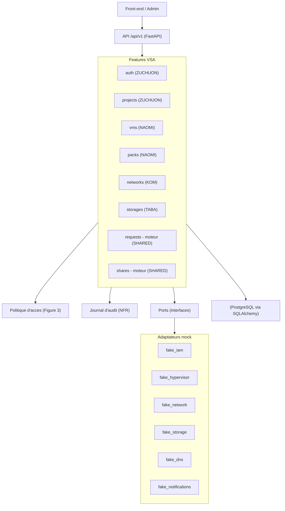
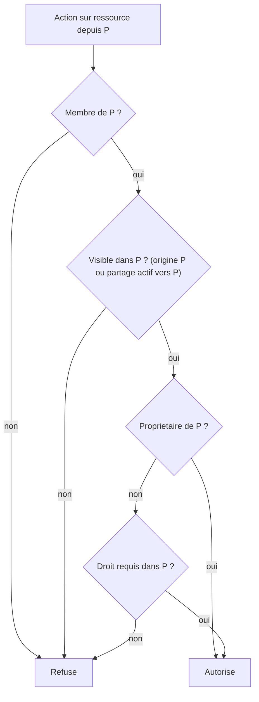

# Mise en place de la codebase Backend IaaS (VSA/hexagonale)

Socle partage genere a 100% + squelettes par port (chaque dev implemente ensuite sa logique), conteneurise via docker-compose + PostgreSQL, Alembic pour le schema, le tout livre en local sur `develop`.

## 1. Architecture cible



Principe (PDF section 2.1) : le backend ne realise aucune action technique, chaque dependance externe est isolee derriere un port, remplace par un mock tant que l'integration n'est pas faite.

## 2. Repartition par developpeur (dossiers dedies, zero conflit Git)

- ZUCHUON (IAM) : [app/application/ports/iam.py](app/application/ports/iam.py), [app/infrastructure/iam/](app/infrastructure/iam/), [app/features/auth/](app/features/auth/), [app/features/profiles/](app/features/profiles/), nouveau `app/features/projects/` (F12, F13, membres, invitations) et le traitement admin des demandes (F16). Modele `app/shared/models/projects.py`.
- NAOMI (VM) : nouveau `app/features/vms/` (F1 a F6), `app/features/packs/` (F17), endpoint de partage de VM (F14), declenchement DNS a la suppression. Ports `app/application/ports/hypervisor.py` + `dns.py`, mocks associes. Modeles `vms.py`, `packs.py`.
- KOM (Reseau) : nouveau `app/features/networks/` (F7). Port `app/application/ports/network.py` + mock. Modele `networks.py`.
- TABA (Espaces) : nouveau `app/features/storages/` (F8 a F11), endpoint de partage de stockage (F14). Port `app/application/ports/storage.py` + mock. Modele `storages.py`.
- SHARED (genere a 100% par moi) : `core/` (erreurs, pagination, audit), tous les modeles de domaine, les moteurs generiques `features/requests/` et `features/shares/`, la politique d'acces `shared/policies/access.py`, le port + mock `notifications`, le cablage `/api/v1`, Docker, Alembic, seed, `.cursorrules`, README.

## 3. Arborescence cible

Legende : [S]=Shared (moi, 100%), [Z]=ZUCHUON, [N]=NAOMI, [K]=KOM, [T]=TABA.

```
app/
  main.py                      # [S] FastAPI, lifespan (seed), handlers d'erreurs, health, monte /api/v1
  api/v1/router.py             # [S] APIRouter prefix=/api/v1 incluant tous les routers
  core/
    settings.py                # [S] DATABASE_URL (postgres en conteneur, sqlite en test)
    database.py                # [S] engine/session (postgres + sqlite)
    dependencies.py            # [S] fournit tous les ports (mocks)
    tokens.py                  # [S] existant
    errors.py                  # [S] ErrorOut + catalogue ErrorCode + error_responses() (NFR API)
    pagination.py              # [S] listes paginees (NFR echelle)
    audit.py                   # [S] journal horodate (NFR tracabilite)
  application/ports/
    iam.py                     # [Z] existant (+ list_members)
    hypervisor.py network.py storage.py dns.py   # [N]/[K]/[T]/[N] interfaces 100%
    notifications.py           # [S] interface 100%
  infrastructure/
    iam/fake_iam.py            # [Z] existant
    hypervisor/ network/ storage/ dns/           # [N]/[K]/[T]/[N] mocks minimaux
    notifications/fake_notifications.py          # [S] mock (ex-email)
  features/
    auth/ profiles/            # [Z] existants (realignes aux conventions)
    projects/                  # [Z] squelette: F12, F13, membres, invitations, F16
    vms/ packs/                # [N] squelettes: F1-F6, F17, partage VM
    networks/                  # [K] squelette: F7
    storages/                  # [T] squelette: F8-F11, partage stockage
    requests/                  # [S] moteur generique de demandes (F15 + dispatch F16) 100%
    shares/                    # [S] moteur generique de partages (liste, revocation) 100%
  shared/
    models/ base.py identities.py rights.py      # existants
            projects.py vms.py packs.py storages.py networks.py requests.py shares.py audit.py  # [S] 100%
    policies/access.py         # [S] controle d'acces Figure 3, 100%
    seed/                      # [S] existant (+ packs par defaut)
alembic/ (env.py + versions/)  # [S]
Dockerfile  docker-compose.yml  .dockerignore  .cursorrules  # [S]
tests/                         # miroir de app/ (voir section 7)
```

## 4. Modele du domaine (modeles SQLAlchemy, generes a 100%)

Reprend fidelement la section 4 du PDF. Je genere tous les modeles maintenant (necessaire a la migration Alembic initiale et au demarrage) ; la colonne "owner" indique qui fera evoluer la logique.

- `projects.py` [Z] : `Project(id, name, owner_id, created_at)`, `Membership(id, project_id, user_id, role, created_at)` + table `membership_rights`, `Invitation(id, project_id, inviter_id, invitee_ref, status, profile_id, rights_snapshot, created_at)`.
- `vms.py` [N] : `Vm(id, origin_project_id, name, ram, cpu, vram, ssd, pack_id?, state, created_at)`.
- `packs.py` [N] : `Pack(id, name, ram, cpu, vram, ssd)`.
- `storages.py` [T] : `Storage(id, origin_project_id, name, size, state, created_at)`.
- `networks.py` [K] : `Network(id, project_id, name, created_at)` + table `network_vms`.
- `requests.py` [S] : `Demande(id, project_id, author_id, kind, status, payload JSON, target_resource_type?, target_resource_id?, admin_note?, created_at, decided_at)` ; `kind` dans {vm_create, vm_update, storage_create, storage_update} ; `status` dans {pending, accepted, refused, cancelled} (cycle 6.1).
- `shares.py` [S] : `Partage(id, resource_type, resource_id, origin_project_id, dest_project_id, created_by, status, created_at)` ; `status` dans {active, revoked} (cycle 6.3).
- `audit.py` [S] : `AuditLog(id, actor_id, action, entity_type, entity_id, created_at, data JSON)` sans donnee sensible.

Appartenance et droits restent portes par le `IamPort` existant (proprietaire = tous les droits, invitation = droits exacts, droits par type). Le modele `Project` ajoute le nom et les metadonnees ; l'`Invitation` ajoute le cycle de vie (envoyee -> acceptee/refusee/annulee) et materialise l'appartenance via `iam.invite_user` a l'acceptation.

## 5. Politique d'acces partagee (shared/policies/access.py, 100%)

Implemente exactement la Figure 3. Pour une action d'un utilisateur sur une ressource depuis un projet P :



Entrees : identite, projet P, ressource, droit requis. S'appuie sur `iam.get_rights`/`iam.list_projects`, l'origine de la ressource et les partages actifs (R12, F5 : partage verifie a chaque acces).

## 6. Ports et mocks (hexagonal)

Interfaces generees a 100% (contrats partages), adaptateurs mock minimaux fonctionnels pour que l'app demarre. Exemple de contrat (hyperviseur) :

```python
class HypervisorPort(ABC):
    """Port vers le groupe Hyperviseur (XCP-ng). Contrat uniquement, jamais l'implementation."""
    @abstractmethod
    async def create_vm(self, spec: VmSpec) -> VmRef: ...
    @abstractmethod
    async def update_vm(self, ref: VmRef, spec: VmSpec) -> None: ...
    @abstractmethod
    async def power(self, ref: VmRef, action: PowerAction) -> None: ...
    @abstractmethod
    async def console(self, ref: VmRef) -> ConsoleAccess: ...
    @abstractmethod
    async def delete_vm(self, ref: VmRef) -> None: ...
```

Ports a creer : `hypervisor`, `network`, `storage`, `dns` (suppression du nom de domaine a la suppression d'une VM, R24), `notifications` (NFR notifications, remplace `email`). Chaque appel documente delai max et rejouabilite sans effet de bord (NFR disponibilite).

## 7. Moteurs generiques (features/requests et features/shares, 100%)

- requests : service `submit/cancel(F15)/accept/refuse(F16)` + registre de handlers par `kind`. L'admin (ZUCHUON) appelle `accept(id)` qui delegue au handler enregistre par NAOMI/TABA (creation/modif via le port concerne). Gere aussi R14 (modification d'un pack -> demandes vm_create en attente mises a jour et renvoyees a l'admin).
- shares : service `list/revoke` + helper de visibilite utilise par la politique d'acces. La creation de partage est exposee par vms (F14 VM) et storages (F14 stockage) ; revocation generique. Applique R15 a R20 (meme proprietaire, aucun droit transmis, revocation en cascade a la suppression).

## 8. Contrat d'API strict et conventions (integration facile)

Objectif : une API triviale a integrer, sans surprise. Regles imposees a CHAQUE route (verifiees par un test de conformite automatise et par `.cursorrules`) :

- Schema entrant explicite : tout corps de requete est un modele Pydantic dedie (`XxxIn`), avec types, contraintes (min/max, formats) et exemples. Les parametres de chemin et de requete sont types ; les filtres et la pagination passent par un modele `ListQuery` commun. Aucune route n'accepte de contenu libre non valide.
- Schema sortant explicite : chaque route declare `response_model=XxxOut` (ou `Page[XxxOut]` pour les listes) et un `status_code` explicite. Jamais de retour non type ; les modeles `*Out` portent des exemples.
- Erreurs explicites et documentees : format homogene `{"error": {"code", "message", "details"?}}` ou `code` vient d'un catalogue stable `ErrorCode`. Chaque route declare ses erreurs possibles via `responses=error_responses(...)` afin qu'elles figurent dans l'OpenAPI (schema `ErrorOut` + exemples). Les exceptions (IamError, ProfileError, acces refuse, etat de cycle de vie invalide, port externe indisponible) sont mappees vers des couples (statut HTTP, code) deterministes par des handlers globaux dans [app/main.py](app/main.py).
- Catalogue d'erreurs partage : enum `ErrorCode` (`unauthorized`, `forbidden`, `not_found`, `conflict`, `validation_error`, `invalid_state`, `upstream_unavailable`, ...) et correspondance statut<->code, pour que l'integrateur connaisse toutes les erreurs a l'avance.
- Statuts coherents : 201 + corps a la creation, 204 sans corps a la suppression, 404 introuvable, 409 conflit, 401/403 selon la Figure 3, 422 validation, 503 `upstream_unavailable` quand un groupe externe (port) est indisponible (NFR : jamais appliquee a moitie).
- Securite documentee : schema Bearer dans l'OpenAPI ; toute route protegee annonce ses reponses 401/403.
- DX OpenAPI : `tags`, `summary`, `description` et `operation_id` stables par route (generation de clients fiable), exemples d'entree et de sortie, enums exposes ; doc interactive sur `/api/v1/docs`, schema sur `/api/v1/openapi.json`.

Modele de route impose (exemple) :

```python
@router.post(
    "/projects",
    response_model=ProjectOut,                     # schema sortant obligatoire
    status_code=status.HTTP_201_CREATED,
    responses=error_responses(ErrorCode.unauthorized, ErrorCode.validation_error),  # erreurs documentees
    summary="Creer un projet",
    operation_id="create_project",
)
async def create_project(body: ProjectCreateIn, identity: Identity = Depends(get_current_identity)):
    """F12 : cree un projet dont l'appelant devient proprietaire."""
    ...
```

Un test de conformite parcourt `app.routes` et echoue si une route n'a pas de `response_model` (hors 204) ou ne documente pas ses erreurs ; `error_responses(*codes)` ([app/core/errors.py](app/core/errors.py)) empeche d'oublier la doc des erreurs.

Autres conventions :

- Versionnage API : tout sous `/api/v1` via [app/api/v1/router.py](app/api/v1/router.py) ; les routes existantes deviennent `/api/v1/auth/...` et `/api/v1/admin/...`.
- Pagination homogene : toutes les listes renvoient `Page[T]` via [app/core/pagination.py](app/core/pagination.py) (projets, ressources, demandes, membres).
- Tests : un fichier de test dedie par fonction publique / endpoint / methode de service et de port (base + edge cases) ; `tests/` en miroir de `app/`, nommage `test_<fonction>.py`. Les tests existants (auth, profils) sont realignes et `tests/unit/core/test_tokens.py` deplace dans la structure miroir.
- Commentaires systematiques sur chaque fichier, classe et fonction (role exact).
- Interdiction du tiret cadratin : usage exclusif du tiret simple.

## 9. Docker, base de donnees, Alembic (image legere, lancement en une commande)

Lancement complet du projet en UNE seule commande :

```bash
docker compose up --build
```

Elle construit l'image, demarre PostgreSQL, attend qu'il soit sain, applique les migrations Alembic, insere le seed, puis sert l'API sur <http://localhost:8000> (doc sur `/api/v1/docs`). Aucune etape manuelle.

[Dockerfile](Dockerfile) multi-stage pour une image minimale : pas d'outils de build dans l'image finale (grace a `psycopg[binary]`), utilisateur non root, aucun cache pip, aucun `.pyc`, et seul le code utile est copie.

```dockerfile
# Etape 1 : construction des dependances (isolee, jetee ensuite)
FROM python:3.11-slim AS builder
ENV PIP_NO_CACHE_DIR=1 PYTHONDONTWRITEBYTECODE=1
WORKDIR /app
COPY requirements.txt .
RUN pip install --no-cache-dir --prefix=/install -r requirements.txt

# Etape 2 : image finale minimale (runtime + code uniquement)
FROM python:3.11-slim AS runtime
ENV PYTHONDONTWRITEBYTECODE=1 PYTHONUNBUFFERED=1
WORKDIR /app
RUN useradd --create-home --uid 1000 appuser
COPY --from=builder /install /usr/local
COPY app ./app
COPY alembic ./alembic
COPY alembic.ini ./
USER appuser
EXPOSE 8000
# Healthcheck sans curl (stdlib python) pour ne rien ajouter a l'image
HEALTHCHECK --interval=15s --timeout=3s --retries=5 \
  CMD python -c "import urllib.request; urllib.request.urlopen('http://localhost:8000/api/v1/health')" || exit 1
# Migrations puis API (bind 0.0.0.0)
CMD ["sh", "-c", "alembic upgrade head && uvicorn app.main:app --host 0.0.0.0 --port 8000"]
```

[docker-compose.yml](docker-compose.yml) : orchestre `db` + `api` ; l'API attend que la base soit saine, migrations et seed se lancent automatiquement au demarrage de `api`.

```yaml
services:
  db:
    image: postgres:16-alpine
    environment:
      POSTGRES_USER: iaas
      POSTGRES_PASSWORD: iaas
      POSTGRES_DB: iaas
    volumes:
      - pgdata:/var/lib/postgresql/data
    healthcheck:
      test: ["CMD-SHELL", "pg_isready -U iaas -d iaas"]
      interval: 5s
      timeout: 3s
      retries: 10

  api:
    build: .
    depends_on:
      db:
        condition: service_healthy
    environment:
      DATABASE_URL: postgresql+psycopg://iaas:iaas@db:5432/iaas
      IAM_JWT_SECRET: dev-secret-change-me
      IAM_SEED_DEMO_USERS: "true"
    ports:
      - "8000:8000"

volumes:
  pgdata:
```

[.dockerignore](.dockerignore) : reduit le contexte de build (image plus legere, build plus rapide).

```
.git
.github
.cursor
.venv
venv
__pycache__
*.py[cod]
.pytest_cache
.ruff_cache
.mypy_cache
.coverage*
htmlcov
tests
docs
*.md
.env
.env.*
!.env.example
*.db
*.sqlite*
build
dist
*.egg-info
Dockerfile
docker-compose.yml
.dockerignore
```

[.gitignore](.gitignore) optimise (surensemble de l'existant : Python, venv, secrets, caches, bases locales, Docker local, editeurs, OS).

```
# Python
__pycache__/
*.py[cod]
*.egg-info/
build/
dist/

# Environnements virtuels
.venv/
venv/
env/

# Secrets et config locale
.env
.env.*
!.env.example

# Caches outils
.pytest_cache/
.ruff_cache/
.mypy_cache/
.coverage
.coverage.*
htmlcov/

# Bases locales
*.db
*.db-*
*.sqlite
*.sqlite3

# Docker local
docker-compose.override.yml

# Editeurs et OS
.idea/
.vscode/
.DS_Store
Thumbs.db
```

Alembic : `alembic.ini`, `alembic/env.py` (importe `Base.metadata` + tous les modeles), migration initiale couvrant tout le schema. Retrait du `create_all` provisoire de [app/main.py](app/main.py) ; le lifespan ne fait plus que le seed (droits, profils, packs par defaut). Ajout d'un endpoint `GET /api/v1/health` (utilise par le healthcheck et pratique pour l'integration). `psycopg[binary]` ajoute a [requirements.txt](requirements.txt) ; SQLite conserve uniquement pour la suite de tests (en memoire).

## 10. .cursorrules

Fichier [.cursorrules](.cursorrules) encodant : architecture VSA/hexagonale et isolation par ports ; mock obligatoire des dependances externes ; frontieres de dossiers par developpeur (ZUCHUON/NAOMI/KOM/TABA) ; commentaires systematiques ; interdiction du tiret cadratin ; un fichier de test par fonction (base + edge) ; conteneurisation Docker ; versionnage `/api/v1` ; contrat d'API strict (schema entrant et sortant type + erreurs documentees sur chaque route) ; reponses en francais ; conformite stricte au PDF.

## 11. README

Mise a jour de [readme.md](readme.md) : organisation de l'equipe et repartition des dossiers (qui possede quoi), nouvelle arborescence VSA, demarrage en une commande via `docker compose up --build`, workflow Git sur `develop`, correction de la reference au PDF (`docs/conception-iaas-api.pdf`).

## 12. Nettoyage (livrable 5)

- Suppression des dossiers de tests vides/redondants `tests/unit/` et `tests/integration/` (contenu utile deplace dans la structure miroir).
- Suppression de `app/infrastructure/email/` remplace par `app/infrastructure/notifications/`.
- Correction de la reference PDF obsolete dans le README.

## 13. Livraison Git

Creation de `develop` depuis `main`, commits locaux structures par lot (socle, ports, moteurs, squelettes, docker, docs), inclusion de `docs/`. Aucun push (tu pousseras toi-meme).

## Verification finale

- `docker compose up --build` lance tout le projet en une seule commande (PostgreSQL sain -> migrations -> seed -> API) ; `GET /api/v1/health` repond, `GET /api/v1/docs` et `/api/v1/openapi.json` exposent toute la surface.
- Chaque route possede un schema entrant type, un `response_model` (ou 204) et ses erreurs documentees ; le test de conformite du contrat d'API passe.
- `pytest` et `ruff check .` passent sur le socle genere.
- Chaque dev peut implementer son port sans toucher aux fichiers des autres.
