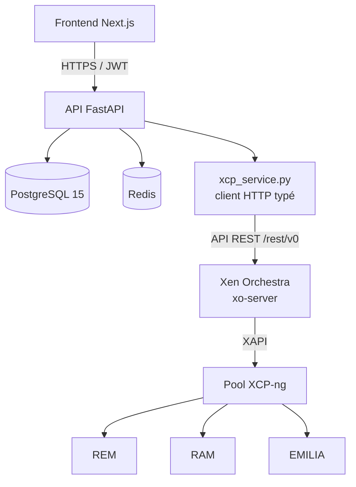

# Proposition technologique — Migration Proxmox → XCP-ng

### Projet Horizon — SIGMA / ENSPY

---

## Contexte

Le changement d'hyperviseur (Proxmox VE → **XCP-ng**) n'affecte qu'une seule brique de l'architecture Horizon : la couche d'intégration avec l'infrastructure de virtualisation. Le reste de la pile (backend, base de données, cache, ordonnanceur) reste pertinent et n'a pas besoin d'être reconsidéré. Ce document précise où se situe l'impact réel, pourquoi, et ce qui ne change pas.

---

## 1. Le changement central : piloter XCP-ng

### 1.1 XCP-ng en quelques mots

XCP-ng est un hyperviseur de type 1 basé sur **Xen** (et non KVM comme Proxmox), maintenu par Vates. C'est une alternative 100 % libre à Citrix XenServer. Son fonctionnement diffère de Proxmox sur deux points qui impactent directement le code :

- les VM sont identifiées par un **UUID** (ex. `770aa52a-fd42-8faf-f167-8c5c4a237cac`), pas par un entier type `vmid` ;
- l'hyperviseur seul n'expose pas d'API REST conviviale : il parle **XAPI**, un protocole de gestion plus bas niveau, historiquement issu de XenServer.

### 1.2 Le vrai choix architectural

Deux options sont possibles pour que le backend FastAPI pilote le pool XCP-ng :

| Option | Description | Verdict |
| --- | --- | --- |
| **XAPI direct** | Le backend parle XAPI directement à chaque hôte (REM, RAM, EMILIA) | ❌ Écarté |
| **Xen Orchestra (XO) + API REST** | Un serveur XO central gère le pool, le backend appelle son API REST | ✅ Retenu |

**Pourquoi écarter XAPI direct :** il faudrait gérer soi-même la bascule entre les 3 hôtes, la session XAPI, et un protocole plus verbeux. C'est le travail que fait déjà Xen Orchestra — le réinventer n'apporte rien.

**Pourquoi Xen Orchestra :** XO est l'outil d'orchestration officiel de l'écosystème XCP-ng. Son serveur (`xo-server`) parle XAPI nativement et centralise la gestion de l'ensemble du pool (REM/RAM/EMILIA vus comme un seul pool), exactement le rôle que jouait l'API Proxmox native dans l'ancienne architecture. Vates a publié une **API REST** à cet effet, explicitement recommandée pour tout usage d'automatisation, et déclarée prête pour la production. Elle couvre les objets dont Horizon a besoin : `vms`, `hosts`, `pools`, `srs` (stockage), `networks`, `tasks`.

> Cette API REST remplace un à un le rôle que jouait Proxmoxer dans l'ancienne architecture (`PXR` dans les diagrammes de séquence déjà produits) — seul le nom du service et le format des identifiants changent, pas sa position dans l'architecture.

### 1.3 Déploiement de Xen Orchestra : from source, pas XOA

Vates propose deux distributions de XO :

| Édition | Coût | Fonctionnalités |
| --- | --- | --- |
| **XOA** (appliance officielle) | Payant (offre d'essai limitée dans le temps) | Support pro, mises à jour simplifiées |
| **XO from the sources** | Gratuit, open source | Toutes les fonctionnalités, y compris l'API REST complète |

**Recommandation : XO from the sources.** Dans un contexte académique sans budget de support commercial, cette édition donne un accès complet à l'API REST sans aucune restriction de fonctionnalité — le seul compromis est une installation manuelle (Node.js) plutôt qu'une appliance clé en main. Pour un pool de 3 hôtes gérés par une équipe technique (Team 4), c'est un compromis largement acceptable.

### 1.4 Client Python : pas de SDK officiel mûr

Il n'existe pas de SDK Python officiel maintenu par Vates pour l'API REST de XO (seuls des paquets communautaires non officiels existent). Plutôt que de dépendre d'une librairie tierce peu éprouvée, la recommandation est d'écrire un **client HTTP typé interne**, sur le même principe que l'intégration CamPay déjà réalisée dans ce projet : appels HTTP bruts via `httpx`, modèles de réponse typés (Pydantic), gestion des retries et des erreurs. C'est un pattern déjà maîtrisé par l'équipe et qui évite une dépendance externe fragile sur un composant critique.

```
app/services/xcp_service.py      # remplace l'ancien proxmoxer_service
  ├── authenticate()              # POST /rest/v0/users/me/authentication_tokens
  ├── create_vm(...)
  ├── get_vm_status(uuid)
  ├── start_vm(uuid) / stop_vm(uuid)
  └── get_cluster_resources()     # GET /rest/v0/hosts, /rest/v0/pools
```

---

## 2. Impact sur le modèle de données

Changements à prévoir dans `horizon_db` (migration Alembic dédiée) :

| Champ actuel | Nouveau champ | Raison |
| --- | --- | --- |
| `proxmox_vmid` (Integer) | `xcp_vm_uuid` (String(36)) | XCP-ng identifie les VM par UUID, pas par entier |
| `PhysicalNode` enum (REM/RAM/EMILIA) | **Inchangé** | Ce sont vos noms de serveurs, indépendants de l'hyperviseur |
| *(nouveau)* | `sr_uuid` (String(36), nullable) | Référence au Storage Repository XCP-ng utilisé, utile pour le suivi du stockage par VM |

Le reste du schéma (`users`, `roles`, `quotas`, `audit_logs`, `reservations`...) est totalement indépendant de l'hyperviseur et ne nécessite aucune modification.

---

## 3. Reste de la pile technologique — confirmée, inchangée

| Composant | Choix | Justification (rappel) |
| --- | --- | --- |
| Backend | FastAPI | Async natif, validation Pydantic, aucune dépendance à l'hyperviseur |
| ORM / Migrations | SQLAlchemy 2.0 + Alembic | Déjà en place, une seule migration à ajouter |
| Base de données | PostgreSQL 15 | Aucun impact |
| Cache / PubSub | Redis | Aucun impact |
| Tâches planifiées | APScheduler | Les jobs (expiration, purge) changent juste d'appel interne (XO au lieu de Proxmoxer) |
| Frontend | Next.js | Aucun impact — consomme toujours l'API FastAPI |

---

## 4. Architecture globale



---

## 5. Points de vigilance

- **Hébergement de Xen Orchestra** : `xo-server` doit tourner quelque part — généralement une petite VM dédiée sur l'un des trois hôtes du pool, à provisionner en amont.
- **Maturité de l'API REST** : Vates la décrit comme quasi complète et prête pour la production, mais certaines opérations avancées restent encore accessibles uniquement via l'API JSON-RPC interne. À vérifier au cas par cas pendant l'implémentation.
- **Sécurité du token XO** : le token d'authentification REST doit être stocké avec la même rigueur que `JWT_SECRET_KEY` (variable d'environnement, jamais en dur).
- **Données existantes** : si des VM de test ont déjà été créées via Proxmoxer, le `seed.py` devra être régénéré avec des `xcp_vm_uuid` plausibles plutôt que les anciens `proxmox_vmid`.

---

## Prochaines étapes suggérées

1. Valider cette orientation avec l'équipe (en particulier Team 4, en charge de la couche virtualisation).
2. Déployer Xen Orchestra from source sur le pool existant.
3. Mettre à jour la migration Alembic (`xcp_vm_uuid`, `sr_uuid`).
4. Réécrire `vm_service.py` et le `xcp_service.py` correspondant.

*Dis-moi si tu veux que j'enchaîne directement sur l'un de ces points.*

---

**Sources consultées** : documentation officielle Xen Orchestra (docs.xen-orchestra.com — architecture, API REST, authentification) et forum officiel XCP-ng (xcp-ng.org — licence XOA vs sources).